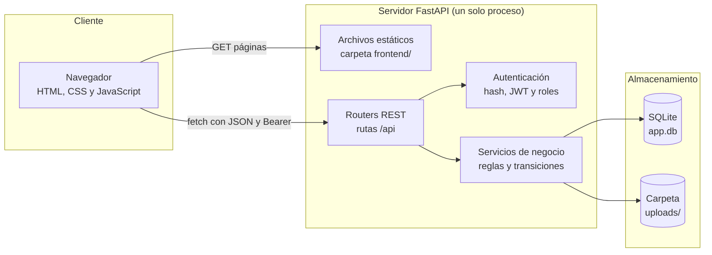
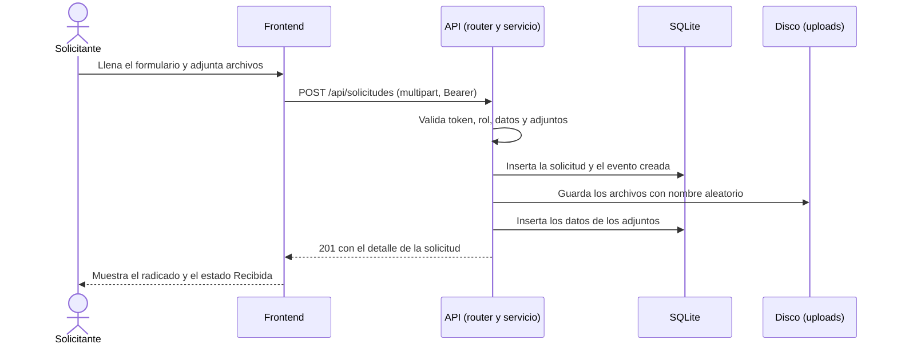
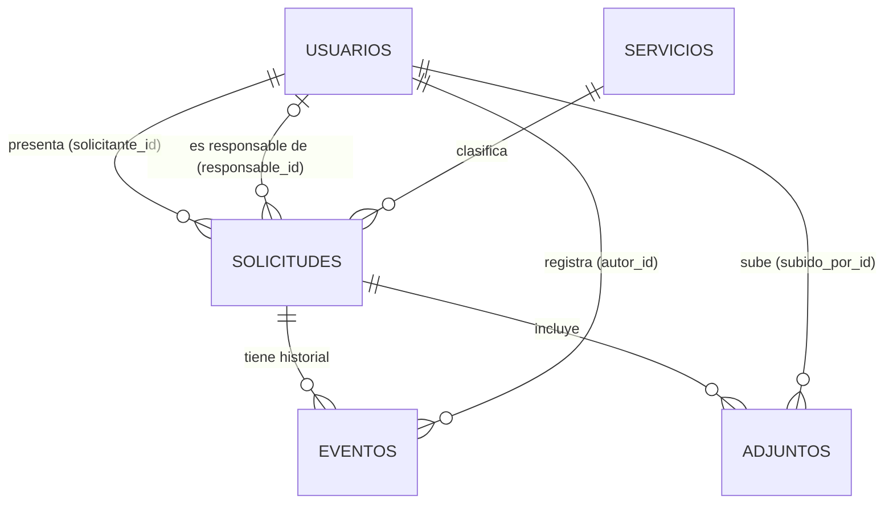
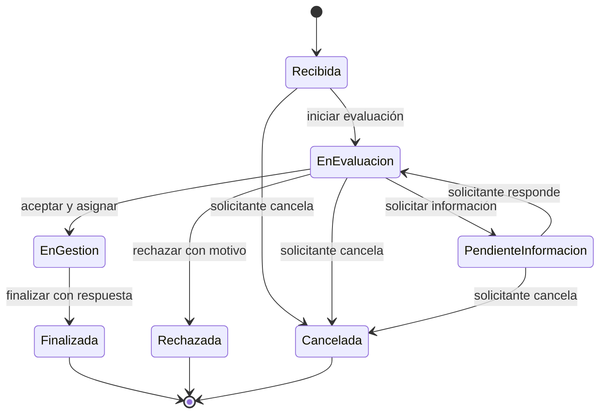

# Diseño – Sistema de gestión de solicitudes de servicio (PF-01)

**Autor:** Berrio (GitHub: KBerrioC)
**Insumos:** [requisitos.md](requisitos.md) y [entrevista.md](entrevista.md)

> **Estado:** completo. Se actualiza si cambian las decisiones durante el desarrollo, y cada cambio queda registrado en su pull request.

## Contenido

1. [Decisiones técnicas](#1-decisiones-técnicas)
2. [Arquitectura](#2-arquitectura)
3. [Modelo de datos](#3-modelo-de-datos)
4. [Especificación de la API](#4-especificación-de-la-api)
5. [Reglas de negocio y control de acceso](#5-reglas-de-negocio-y-control-de-acceso)
6. [Interfaces y recorridos de los actores](#6-interfaces-y-recorridos-de-los-actores)
7. [Correspondencia con los requisitos](#7-correspondencia-con-los-requisitos)

## 1. Decisiones técnicas

| Capa | Tecnología | Justificación |
|---|---|---|
| Backend y API REST | Python con FastAPI y Pydantic | Es la tecnología trabajada en el curso; valida entradas, genera documentación OpenAPI y facilita los códigos HTTP. |
| Persistencia | SQLite con SQLAlchemy (ORM) | Se usó en las prácticas del curso, no requiere instalar un servidor y permite reproducir la ejecución con pocos pasos. |
| Autenticación | JWT con contraseñas con hash y control por rol | Se parte del ejemplo visto en clase; cubre RNF-01 y los permisos por actor. |
| Frontend | HTML, CSS y JavaScript con `fetch`, servido por el propio backend | No requiere compilación ni un segundo servidor; permite consumir la API real. |
| Pruebas | Documentación interactiva de la API (Swagger) y capturas | La guía acepta herramientas de consulta HTTP del curso y no exige automatización. |

## 2. Arquitectura

La aplicación es cliente-servidor y se ejecuta en un solo proceso: FastAPI expone la API REST y también entrega los archivos estáticos del frontend. Los datos se guardan en SQLite y los adjuntos, en disco.

### 2.1 Diagrama de componentes



### 2.2 Responsabilidades

| Componente | Responsabilidad |
|---|---|
| Frontend (HTML, CSS y JavaScript) | Presenta la información, recibe las acciones del usuario, valida datos básicos y consume la API con `fetch`. Guarda el token de sesión en `sessionStorage`. Muestra los datos con `textContent` para evitar inyección de código. |
| Routers REST | Reciben las solicitudes HTTP, validan el formato con Pydantic, aplican el control de acceso por rol y devuelven los códigos de respuesta. No contienen reglas de negocio. |
| Autenticación | Genera y verifica los JWT, comprueba el hash de las contraseñas y entrega el usuario autenticado a cada endpoint. |
| Servicios de negocio | Aplican las reglas (RN-01 a RN-12): transiciones, responsables, prioridades, cancelación y creación de eventos en la misma transacción. |
| SQLite y SQLAlchemy | Persisten usuarios, servicios, solicitudes, eventos y datos de los adjuntos, con claves foráneas activas. |
| Carpeta `uploads/` | Guarda los archivos con un nombre aleatorio. Está fuera del control de versiones y solo se accede por EP-17. |

### 2.3 Organización del código

La guía no impone una estructura de carpetas. Esta separa el acceso HTTP, las reglas de negocio y los datos, parte de la organización vista en la práctica de Clase 7 y permite probar y explicar cada capa por separado.

```
backend/
  main.py            Crea la aplicación, registra los routers y sirve el frontend
  config.py          Lee las variables de entorno (.env)
  database.py        Conexión, sesión y activación de claves foráneas
  models.py          Tablas (SQLAlchemy)
  schemas.py         Entradas y salidas (Pydantic)
  auth.py            Hash, JWT y dependencias de rol
  routers/           auth.py, servicios.py, solicitudes.py, adjuntos.py, resumen.py
  services/          solicitudes.py (reglas y transiciones), archivos.py (adjuntos)
  seed.py            Datos ficticios iniciales (usuarios y servicios)
frontend/
  index.html         Inicio de sesión y registro
  mis-solicitudes.html, nueva-solicitud.html, solicitud.html, bandeja.html, resumen.html
  css/estilos.css
  js/api.js          Cliente de la API (token y manejo de errores)
  js/…               Un archivo por pantalla
uploads/             Adjuntos (ignorada por Git)
requirements.txt
```

### 2.4 Recorrido de una petición

Ejemplo con la creación de una solicitud (EP-06):



Si la base de datos falla, la transacción se revierte y se eliminan los archivos ya guardados, para no dejar adjuntos huérfanos.

## 3. Modelo de datos

El modelo tiene cinco tablas. Los valores de `rol`, `estado`, `prioridad`, `tipo` y similares se almacenan como texto y se restringen con `CHECK`.

### 3.1 Diagrama entidad-relación



`solicitudes` referencia dos veces a `usuarios`: `solicitante_id` (quien presenta, obligatorio) y `responsable_id` (quien atiende, nulo hasta la asignación). `eventos` referencia tres veces a `usuarios`: `autor_id`, `de_responsable_id` y `a_responsable_id`.

### 3.2 Tablas

**`usuarios`**

| Campo | Tipo | Restricciones y notas |
|---|---|---|
| id | entero | Clave primaria |
| nombre | texto | Obligatorio |
| correo | texto | Obligatorio, único |
| password_hash | texto | Obligatorio; nunca se guarda la contraseña |
| rol | texto | `solicitante`, `atencion` o `coordinacion` |
| tipo_solicitante | texto | Nulo; `estudiante`, `docente`, `egresado` o `externo`, solo para solicitantes |
| activo | booleano | Por defecto verdadero |
| creado_en | fecha y hora | Obligatorio |

**`servicios`**

| Campo | Tipo | Restricciones y notas |
|---|---|---|
| id | entero | Clave primaria |
| nombre | texto | Obligatorio, único |
| descripcion | texto | |
| requiere_adjunto | booleano | Si es verdadero, la solicitud exige al menos un adjunto (RN-06) |
| prioridad_defecto | texto | `alta`, `media` o `baja` (RN-09) |
| activo | booleano | Por defecto verdadero |

**`solicitudes`**

| Campo | Tipo | Restricciones y notas |
|---|---|---|
| id | entero | Clave primaria |
| radicado | texto | Obligatorio, único; formato `SOL-AAAA-NNNNN` |
| solicitante_id | entero | FK → `usuarios.id`, obligatorio |
| servicio_id | entero | FK → `servicios.id`, obligatorio |
| asunto | texto | Obligatorio |
| descripcion | texto | Obligatorio |
| estado | texto | `recibida`, `en_evaluacion`, `pendiente_informacion`, `en_gestion`, `finalizada`, `rechazada` o `cancelada` |
| prioridad | texto | `alta`, `media` o `baja`; copia la del servicio al crear y puede ajustarse (RN-09) |
| responsable_id | entero | FK → `usuarios.id`, nulo hasta asignar; debe ser personal de atención (RN-07) |
| respuesta | texto | Nulo hasta finalizar (RN-04) |
| creado_en | fecha y hora | Obligatorio |
| actualizado_en | fecha y hora | Obligatorio |
| finalizado_en | fecha y hora | Nulo hasta finalizar |

**`eventos`** (historial de trazabilidad)

| Campo | Tipo | Restricciones y notas |
|---|---|---|
| id | entero | Clave primaria |
| solicitud_id | entero | FK → `solicitudes.id`, obligatorio |
| autor_id | entero | FK → `usuarios.id`, obligatorio |
| tipo | texto | `creada`, `evaluacion_iniciada`, `informacion_solicitada`, `informacion_recibida`, `aceptada`, `rechazada`, `asignada`, `reasignada`, `prioridad_cambiada`, `nota`, `finalizada` o `cancelada` |
| estado_anterior | texto | Nulo |
| estado_nuevo | texto | Nulo |
| de_responsable_id | entero | FK → `usuarios.id`, nulo; para reasignaciones (RN-08) |
| a_responsable_id | entero | FK → `usuarios.id`, nulo; para asignaciones y reasignaciones (RN-08) |
| detalle | texto | Nulo; motivo, nota o comentario |
| visible_solicitante | booleano | Falso para notas internas (RN-05) |
| creado_en | fecha y hora | Obligatorio |

**`adjuntos`**

| Campo | Tipo | Restricciones y notas |
|---|---|---|
| id | entero | Clave primaria |
| solicitud_id | entero | FK → `solicitudes.id`, obligatorio |
| subido_por_id | entero | FK → `usuarios.id`, obligatorio |
| proposito | texto | `solicitud`, `informacion` o `respuesta` |
| nombre_original | texto | Nombre del archivo que subió el usuario |
| nombre_almacenado | texto | Nombre aleatorio con el que se guarda en disco |
| tipo_mime | texto | PDF, JPG o PNG (RNF-05) |
| tamano_bytes | entero | Máximo definido por `MAX_UPLOAD_MB` (RNF-05) |
| creado_en | fecha y hora | Obligatorio |

### 3.3 Integridad e índices

- Todas las claves foráneas usan `ON DELETE RESTRICT`: no se elimina un usuario, servicio o solicitud con registros asociados.
- En SQLite se activa `PRAGMA foreign_keys = ON` en cada conexión; de lo contrario las claves foráneas no se hacen cumplir (RNF-04).
- Restricciones `CHECK` en `rol`, `estado`, `prioridad`, `tipo` y `proposito`.
- Índices en `solicitudes` por `estado`, `responsable_id`, `solicitante_id` y `servicio_id`, y en `eventos` por `solicitud_id` y `creado_en`, para la bandeja y el resumen.

### 3.4 Decisiones de diseño

1. **Una sola tabla de usuarios con rol.** La autenticación se resuelve una vez y la base de datos garantiza que cada referencia apunte a un usuario existente. Que el solicitante tenga rol `solicitante` y el responsable rol `atencion` lo valida la aplicación (RN-07).
2. **Los tiempos se calculan, no se guardan.** El tiempo pendiente y el tiempo de atención salen de `creado_en` y `finalizado_en` (RN-10), por lo que nunca quedan desactualizados.
3. **Todo el historial en una tabla.** Cambios de estado, asignaciones, prioridad y notas son filas de `eventos`; el campo `visible_solicitante` decide qué ve cada rol (RN-05).
4. **Reglas en la aplicación.** Las transiciones de estado (RN-01), la exigencia de motivo (RN-02), el responsable obligatorio en «En gestión» (RN-03) y la inmutabilidad de estados finales (RN-12) se validan en el servicio, porque dependen del flujo y no solo de un valor.
5. **Adjuntos en disco, metadatos en la base de datos.** El archivo se guarda con un nombre aleatorio fuera del control de versiones y solo se descarga por un endpoint autorizado (RNF-05).

### 3.5 Correspondencia con los requisitos

| Tabla | Requisitos que respalda |
|---|---|
| `usuarios` | RF-01, RF-02, RF-03, RN-07 |
| `servicios` | RF-04, RN-06, RN-09 |
| `solicitudes` | RF-05, RF-07, RF-08, RF-09, RF-10, RF-11, RF-13, RF-14, RF-16, RF-18, RF-19 |
| `eventos` | RF-15, RF-17, RN-05, RN-08, CA-04 |
| `adjuntos` | RF-06, RF-12, RF-16, RNF-05 |

## 4. Especificación de la API

### 4.1 Convenciones

- Todas las rutas cuelgan de `/api`. El formato es JSON (UTF-8), salvo los endpoints con archivos (`multipart/form-data`) y el inicio de sesión (`application/x-www-form-urlencoded`, el formato estándar OAuth2, para que el botón *Authorize* de la documentación interactiva funcione).
- Autenticación: cabecera `Authorization: Bearer <token>`. El token es un JWT con expiración (`ACCESS_TOKEN_EXPIRE_MINUTES`). Solo el registro y el inicio de sesión son públicos.
- Las fechas usan el formato ISO 8601.
- Los errores devuelven `{"detail": "mensaje"}`. Los errores de formato (422) usan la estructura estándar de FastAPI y Pydantic.
- No hay `PUT` ni `DELETE`: la cancelación es un cambio de estado y las solicitudes no se eliminan (RNF-09, E-12).
- La documentación interactiva queda disponible en `/docs`.

### 4.2 Resumen de endpoints

| ID | Método | Ruta | Quién | Éxito | Errores | Requisitos |
|---|---|---|---|---|---|---|
| EP-01 | POST | `/api/auth/registro` | Público | 201 | 409, 422 | RF-01 |
| EP-02 | POST | `/api/auth/login` | Público | 200 | 401, 422 | RF-02 |
| EP-03 | GET | `/api/auth/perfil` | Cualquiera | 200 | 401 | RF-02, RF-03 |
| EP-04 | GET | `/api/servicios` | Cualquiera | 200 | 401 | RF-04 |
| EP-05 | GET | `/api/usuarios/atencion` | Atención, coordinación | 200 | 401, 403 | RF-13 |
| EP-06 | POST | `/api/solicitudes` | Solicitante | 201 | 400, 401, 403, 413, 415, 422 | RF-05, RF-06 |
| EP-07 | GET | `/api/solicitudes` | Cualquiera | 200 | 401, 422 | RF-07, RF-09, RF-19 |
| EP-08 | GET | `/api/solicitudes/{id}` | Cualquiera | 200 | 401, 404 | RF-07, RF-19 |
| EP-09 | PATCH | `/api/solicitudes/{id}/estado` | Atención, coordinación | 200 | 400, 401, 403, 404, 409, 422 | RF-10, RF-11 |
| EP-10 | POST | `/api/solicitudes/{id}/finalizacion` | Atención, coordinación | 200 | 401, 403, 404, 409, 413, 415, 422 | RF-16 |
| EP-11 | PATCH | `/api/solicitudes/{id}/responsable` | Atención, coordinación | 200 | 400, 401, 403, 404, 409, 422 | RF-13 |
| EP-12 | PATCH | `/api/solicitudes/{id}/prioridad` | Atención, coordinación | 200 | 401, 403, 404, 409, 422 | RF-14 |
| EP-13 | POST | `/api/solicitudes/{id}/notas` | Atención, coordinación | 201 | 401, 403, 404, 409, 422 | RF-15 |
| EP-14 | POST | `/api/solicitudes/{id}/informacion` | Solicitante | 200 | 401, 403, 404, 409, 413, 415, 422 | RF-12 |
| EP-15 | POST | `/api/solicitudes/{id}/cancelacion` | Solicitante | 200 | 401, 403, 404, 409 | RF-08 |
| EP-16 | GET | `/api/solicitudes/{id}/eventos` | Cualquiera | 200 | 401, 404 | RF-17 |
| EP-17 | GET | `/api/adjuntos/{id}` | Cualquiera autorizado | 200 | 401, 404 | RF-06, RNF-05 |
| EP-18 | GET | `/api/resumen` | Coordinación | 200 | 401, 403, 422 | RF-18 |
| EP-19 | GET | `/api/salud` | Público | 200 | 500 | RNF-07 |

### 4.3 Códigos de error

| Código | Cuándo se usa |
|---|---|
| 400 | Se incumple una regla de negocio: falta un adjunto exigido, el responsable no es de atención o ya es el actual |
| 401 | Sin token, token vencido o credenciales incorrectas |
| 403 | El rol (o el funcionario) no puede hacer esa operación |
| 404 | El recurso no existe, **o existe pero el usuario no puede verlo** (no se revela su existencia) |
| 409 | La operación no es válida para el estado actual (transición no permitida, estado final) o el recurso ya existe (correo repetido) |
| 413 | Adjunto mayor que el tamaño máximo |
| 415 | Adjunto de tipo no permitido |
| 422 | Datos con formato inválido, validados por Pydantic |

### 4.4 Detalle de los endpoints

#### Autenticación y datos básicos

**EP-01 `POST /api/auth/registro`** – Crea una cuenta de solicitante.
- Entrada (JSON): `nombre` (2 a 100 caracteres), `correo` (formato válido), `password` (mínimo 8 caracteres), `tipo_solicitante` (`estudiante`, `docente`, `egresado` o `externo`).
- Salida 201: `{ "id", "nombre", "correo", "rol": "solicitante", "tipo_solicitante" }`. Nunca devuelve la contraseña.
- Errores: 409 si el correo ya existe; 422 si algún dato no cumple el formato.

**EP-02 `POST /api/auth/login`** – Inicia sesión.
- Entrada (formulario): `username` (el correo) y `password`.
- Salida 200: `{ "access_token", "token_type": "bearer", "usuario": { "id", "nombre", "rol" } }`.
- Errores: 401 si el correo o la contraseña son incorrectos, o si el usuario está inactivo. El mensaje es el mismo en ambos casos.

**EP-03 `GET /api/auth/perfil`** – Devuelve `{ "id", "nombre", "correo", "rol", "tipo_solicitante" }` del usuario autenticado.

**EP-04 `GET /api/servicios`** – Devuelve los servicios activos: `[ { "id", "nombre", "descripcion", "requiere_adjunto", "prioridad_defecto" } ]`.

**EP-05 `GET /api/usuarios/atencion`** – Devuelve el personal de atención activo `[ { "id", "nombre", "correo" } ]`, para elegir el responsable.

#### Solicitudes

**EP-06 `POST /api/solicitudes`** – Crea una solicitud (CA-01).
- Entrada (`multipart/form-data`): `servicio_id`, `asunto` (5 a 150 caracteres), `descripcion` (10 a 2000 caracteres) y `archivos` (cero o más).
- Reglas: el servicio debe existir y estar activo. Si el servicio requiere adjunto y no llega ningún archivo, se responde 400 y no se guarda nada (RN-06). Cada archivo debe ser PDF, JPG o PNG, con contenido que corresponda a su extensión, y no superar el máximo (413 y 415). No se admiten más de 5 archivos por solicitud (400) ni archivos vacíos (422).
- Efecto: la solicitud queda en `recibida`, con la prioridad por defecto del servicio, un radicado nuevo y el evento `creada`.
- Salida 201: el detalle de la solicitud (ver EP-08).

**EP-07 `GET /api/solicitudes`** – Lista las solicitudes que el usuario puede ver (sección 5.3).
- Parámetros opcionales: `estado`, `servicio_id`, `prioridad`, `responsable_id`, `limite` (por defecto 20, máximo 100) y `desplazamiento`.
- Orden: para el personal, por prioridad (alta primero) y luego por antigüedad; para el solicitante, de más reciente a más antigua.
- Salida 200: `{ "total", "items": [ { "id", "radicado", "asunto", "servicio", "estado", "prioridad", "solicitante", "responsable", "creado_en", "dias_pendientes" } ] }`. El campo `solicitante` solo se incluye para el personal. `dias_pendientes` es nulo en estados finales (RN-10).

**EP-08 `GET /api/solicitudes/{id}`** – Detalle de una solicitud (CA-03, CA-05).
- Salida 200:

```json
{
  "id": 12,
  "radicado": "SOL-2026-00012",
  "servicio": { "id": 1, "nombre": "Certificado de estudios" },
  "asunto": "Certificado para trámite de beca",
  "descripcion": "Necesito un certificado de estudios del último semestre.",
  "estado": "en_gestion",
  "prioridad": "media",
  "solicitante": { "id": 7, "nombre": "Ana Pérez" },
  "responsable": { "id": 3, "nombre": "Luis Gómez" },
  "respuesta": null,
  "adjuntos": [
    { "id": 5, "nombre_original": "documento.pdf", "proposito": "solicitud", "tipo_mime": "application/pdf", "tamano_bytes": 120345 }
  ],
  "creado_en": "2026-11-17T09:30:00",
  "actualizado_en": "2026-11-17T11:05:00",
  "finalizado_en": null,
  "dias_pendientes": 0,
  "dias_atencion": null
}
```

- Si la solicitud no existe o no es visible para ese usuario, se responde 404.
- Al finalizar, `respuesta` y `finalizado_en` tienen valor, `dias_pendientes` es nulo y `dias_atencion` muestra el tiempo de atención.

**EP-09 `PATCH /api/solicitudes/{id}/estado`** – Mueve la solicitud en el flujo de evaluación (CA-02).
- Entrada (JSON): `estado` (`en_evaluacion`, `en_gestion`, `pendiente_informacion` o `rechazada`), `motivo`, `responsable_id` y `prioridad` (opcionales según el caso).

| `estado` pedido | Desde | Datos obligatorios | Eventos |
|---|---|---|---|
| `en_evaluacion` | `recibida` | Ninguno | `evaluacion_iniciada` |
| `en_gestion` | `en_evaluacion` | `responsable_id` (de atención). `prioridad` opcional | `aceptada`, `asignada` y, si cambia la prioridad, `prioridad_cambiada` |
| `pendiente_informacion` | `en_evaluacion` | `motivo` | `informacion_solicitada` |
| `rechazada` | `en_evaluacion` | `motivo` | `rechazada` |

- Cualquier otro valor de `estado` (por ejemplo `finalizada` o `cancelada`) se rechaza con 422, porque esas acciones tienen su propio endpoint. Una transición no permitida desde el estado actual responde 409 (RN-01). Un dato obligatorio ausente o un responsable que no es de atención responde 400 (RN-02, RN-03, RN-07).
- Ejemplo de entrada para aceptar: `{ "estado": "en_gestion", "responsable_id": 3, "prioridad": "alta" }`.
- Salida 200: el detalle de la solicitud actualizado.

**EP-10 `POST /api/solicitudes/{id}/finalizacion`** – Finaliza con una respuesta (CA-05).
- Entrada (`multipart/form-data`): `respuesta` (10 a 2000 caracteres) y `archivo` opcional (PDF, JPG o PNG).
- Reglas: la solicitud debe estar en `en_gestion` (409 en otro caso) y ser del responsable asignado, salvo que quien llama sea coordinación (403).
- Efecto: estado `finalizada`, `respuesta` y `finalizado_en` guardados, el adjunto con propósito `respuesta` y el evento `finalizada`, visible para el solicitante (RN-04).
- Salida 200: el detalle actualizado.

**EP-11 `PATCH /api/solicitudes/{id}/responsable`** – Reasigna el responsable.
- Entrada (JSON): `responsable_id` y `motivo` opcional.
- Reglas: la solicitud debe estar en `en_gestion` (409). El nuevo responsable debe ser personal de atención activo y distinto del actual (400). El personal de atención solo reasigna las solicitudes que tiene asignadas; coordinación reasigna cualquiera (403).
- Efecto: evento `reasignada` con `de_responsable_id` y `a_responsable_id` (RN-08).
- Salida 200: el detalle actualizado.

**EP-12 `PATCH /api/solicitudes/{id}/prioridad`** – Ajusta la prioridad.
- Entrada (JSON): `prioridad` (`alta`, `media` o `baja`) y `motivo` obligatorio.
- Reglas: la solicitud no debe estar en estado final (409). El personal de atención solo ajusta las suyas; coordinación cualquiera.
- Efecto: evento `prioridad_cambiada` con el motivo (RN-09).
- Salida 200: el detalle actualizado.

**EP-13 `POST /api/solicitudes/{id}/notas`** – Registra una nota o una acción de gestión.
- Entrada (JSON): `texto` (3 a 1000 caracteres) y `visible_solicitante` (por defecto `false`).
- Reglas: la solicitud no debe estar en estado final (409). El personal de atención solo registra notas en las suyas; coordinación en cualquiera.
- Salida 201: el evento creado.

**EP-14 `POST /api/solicitudes/{id}/informacion`** – El solicitante responde a una petición de información.
- Entrada (`multipart/form-data`): `texto` y `archivos` (al menos uno de los dos; si no llega ninguno, 422).
- Reglas: solo el solicitante dueño; la solicitud debe estar en `pendiente_informacion` (409).
- Efecto: estado `en_evaluacion`, adjuntos con propósito `informacion` y evento `informacion_recibida`.
- Salida 200: el detalle actualizado.

**EP-15 `POST /api/solicitudes/{id}/cancelacion`** – El solicitante cancela su solicitud.
- Entrada (JSON): `motivo` opcional.
- Reglas: solo el solicitante dueño; el estado debe ser `recibida`, `en_evaluacion` o `pendiente_informacion` (409 en otro caso, RN-11).
- Efecto: estado `cancelada` y evento `cancelada`.
- Salida 200: el detalle actualizado.

**EP-16 `GET /api/solicitudes/{id}/eventos`** – Historial de trazabilidad (CA-04).
- Salida 200: `[ { "id", "tipo", "autor": { "id", "nombre", "rol" }, "estado_anterior", "estado_nuevo", "detalle", "creado_en" } ]`, ordenado por fecha. El personal ve además `visible_solicitante`.
- El solicitante solo recibe los eventos con `visible_solicitante = true` (RN-05).

**EP-17 `GET /api/adjuntos/{id}`** – Descarga un archivo.
- Devuelve el archivo con su nombre original. Solo lo puede descargar quien puede ver la solicitud a la que pertenece; en otro caso, 404 (RNF-05).

**EP-18 `GET /api/resumen`** – Resumen consolidado para coordinación (CA-06).
- Parámetros opcionales: `desde` y `hasta` (fecha de creación).
- Salida 200:

```json
{
  "total": 48,
  "por_estado": { "recibida": 5, "en_evaluacion": 4, "pendiente_informacion": 2, "en_gestion": 12, "finalizada": 20, "rechazada": 3, "cancelada": 2 },
  "por_servicio": [ { "servicio": "Certificado de estudios", "total": 21 } ],
  "por_responsable": [ { "responsable": "Luis Gómez", "total": 9 } ],
  "tiempo_promedio_atencion_dias": 3.4,
  "pendientes_mas_antiguas": [
    { "id": 4, "radicado": "SOL-2026-00004", "asunto": "Actualización de datos", "estado": "en_gestion", "responsable": "Luis Gómez", "dias_pendientes": 11 }
  ]
}
```

- `por_responsable` cuenta las solicitudes que tienen responsable asignado. `tiempo_promedio_atencion_dias` se calcula con las finalizadas. `pendientes_mas_antiguas` lista las 10 solicitudes no finalizadas con más días pendientes (RN-10, E-08).

**EP-19 `GET /api/salud`** – Comprueba que el servidor responde y que la base de datos es accesible. No requiere sesión.
- Salida 200: `{ "estado": "ok", "base_de_datos": "ok" }`.

## 5. Reglas de negocio y control de acceso

### 5.1 Autenticación y autorización

- Una dependencia de FastAPI obtiene el usuario a partir del token y rechaza con 401 si falta, venció o el usuario está inactivo.
- Otra dependencia exige uno o varios roles y rechaza con 403 cuando no corresponden. Cada endpoint declara los roles permitidos de la tabla 4.2.
- Los permisos se validan siempre en el servidor, aunque la interfaz oculte los botones (RNF-02).

### 5.2 Visibilidad de las solicitudes

| Rol | Solicitudes que puede ver |
|---|---|
| Solicitante | Solo las propias (`solicitante_id` igual a su id) |
| Personal de atención | Las que están en `recibida`, `en_evaluacion` o `pendiente_informacion`, y todas las que tiene asignadas (SUP-10) |
| Coordinación | Todas |

Si una solicitud existe pero el usuario no puede verla, la API responde 404, igual que si no existiera. Así un solicitante no puede deducir qué números de solicitud hay en el sistema (E-06).

Consecuencia verificada en las pruebas: quien asigna una solicitud a otra persona, o la rechaza sin tenerla asignada, deja de verla, salvo coordinación. La interfaz lo lleva entonces a la bandeja con un aviso de que la acción quedó registrada.

### 5.3 Permisos de gestión sobre una solicitud

- **Evaluar** (EP-09): cualquier funcionario de atención y coordinación.
- **Finalizar, reasignar, ajustar prioridad y registrar notas** (EP-10 a EP-13): el responsable asignado o coordinación. Esta restricción es una decisión de diseño que concreta «personal autorizado» de CA-02 y la facultad de coordinación para intervenir (E-07).
- **Informar y cancelar** (EP-14 y EP-15): solo el solicitante dueño.

### 5.4 Cómo se aplica cada regla de negocio

| Regla | Dónde se valida | Respuesta ante incumplimiento |
|---|---|---|
| RN-01 Transiciones válidas | Tabla `TRANSICIONES` consultada por una función del servicio antes de cambiar el estado | 409 |
| RN-02 Motivo en rechazo y petición de información | Validación del cuerpo en EP-09 | 400 |
| RN-03 Responsable para pasar a «En gestión» | EP-09 | 400 |
| RN-04 Respuesta al finalizar | Campo obligatorio de EP-10 | 422 |
| RN-05 Notas internas ocultas | Filtro por rol en EP-16 | El solicitante no las recibe |
| RN-06 Adjunto obligatorio según el servicio | EP-06 | 400, sin guardar nada |
| RN-07 Responsable de atención | Consulta del rol en EP-09 y EP-11 | 400 |
| RN-08 Registro de reasignaciones | EP-09 y EP-11 crean el evento con `de_responsable_id` y `a_responsable_id` | No aplica |
| RN-09 Prioridad | EP-06 copia la del servicio; EP-12 y EP-09 la ajustan con motivo | 422 |
| RN-10 Tiempos | Calculados al consultar, a partir de `creado_en` y `finalizado_en` | No aplica |
| RN-11 Cancelación antes de «En gestión» | EP-15 | 409 |
| RN-12 Estados finales inmutables | La tabla de transiciones no tiene salidas desde ellos; EP-10 a EP-15 lo comprueban | 409 |

### 5.5 Tabla de transiciones

La función de cambio de estado consulta un diccionario con las transiciones de la sección 4 de [requisitos.md](requisitos.md):

| Estado actual | Estados siguientes permitidos |
|---|---|
| `recibida` | `en_evaluacion`, `cancelada` |
| `en_evaluacion` | `en_gestion`, `pendiente_informacion`, `rechazada`, `cancelada` |
| `pendiente_informacion` | `en_evaluacion`, `cancelada` |
| `en_gestion` | `finalizada` |
| `finalizada`, `rechazada`, `cancelada` | Ninguno |

### 5.6 Eventos del historial

Cada acción que cambia una solicitud crea un evento en la misma transacción, de modo que no puede haber un cambio sin su registro: `creada`, `evaluacion_iniciada`, `aceptada`, `asignada`, `reasignada`, `informacion_solicitada`, `informacion_recibida`, `rechazada`, `prioridad_cambiada`, `nota`, `finalizada` y `cancelada`. Son visibles para el solicitante todos los eventos de cambio de estado y la finalización; las notas son internas salvo que se marquen como visibles.

## 6. Interfaces y recorridos de los actores

### 6.1 Pantallas

| ID | Pantalla | Archivo | Quién | Endpoints que usa |
|---|---|---|---|---|
| PAN-01 | Inicio de sesión y registro | `index.html` | Público | EP-01, EP-02, EP-03 |
| PAN-02 | Mis solicitudes | `mis-solicitudes.html` | Solicitante | EP-07 |
| PAN-03 | Nueva solicitud | `nueva-solicitud.html` | Solicitante | EP-04, EP-06 |
| PAN-04 | Detalle de la solicitud | `solicitud.html` | Todos, con acciones según rol y estado | EP-08, EP-16, EP-17 y las acciones EP-09 a EP-15 |
| PAN-05 | Bandeja de gestión | `bandeja.html` | Atención y coordinación | EP-05, EP-07 |
| PAN-06 | Resumen del proceso | `resumen.html` | Coordinación | EP-18 |

Tras iniciar sesión, el frontend lee el rol con EP-03 y lleva a cada actor a su pantalla de inicio: PAN-02 al solicitante, PAN-05 al personal de atención y PAN-06 a coordinación.

### 6.2 Flujo de estados



### 6.3 Recorridos principales

**Solicitante**
1. Se registra (EP-01) e inicia sesión (EP-02).
2. Elige un servicio, escribe el asunto y la descripción, y adjunta los documentos si el servicio los exige (PAN-03, EP-06).
3. Consulta sus solicitudes y su estado (PAN-02).
4. Abre el detalle para ver el historial, y si le piden información, responde con texto o un archivo (PAN-04, EP-14). Puede cancelar mientras no esté en gestión (EP-15).
5. Cuando se finaliza, ve la respuesta y descarga el adjunto si lo hay (PAN-04, EP-08 y EP-17).

**Personal de atención**
1. Inicia sesión y ve la bandeja, ordenada por prioridad y antigüedad (PAN-05, EP-07).
2. Abre una solicitud nueva e inicia la evaluación (EP-09).
3. Resuelve la evaluación: acepta eligiendo responsable y prioridad, pide información con un motivo, o rechaza con un motivo (EP-05 y EP-09).
4. Gestiona las que tiene asignadas: registra notas, ajusta la prioridad o reasigna (EP-11 a EP-13).
5. Finaliza con una respuesta para el solicitante (EP-10).

**Coordinación**
1. Inicia sesión y ve el resumen del proceso (PAN-06, EP-18).
2. Desde la bandeja abre cualquier solicitud para consultar su historial y las notas internas (EP-07, EP-08 y EP-16).
3. Cuando hace falta, interviene: reasigna el responsable, ajusta la prioridad o registra notas (EP-11 a EP-13).

### 6.4 Acciones visibles en el detalle (PAN-04)

El frontend muestra solo las acciones que el rol y el estado permiten. El servidor las valida de todos modos.

| Rol | Estado de la solicitud | Acciones |
|---|---|---|
| Solicitante | `recibida`, `en_evaluacion` | Cancelar |
| Solicitante | `pendiente_informacion` | Responder información, cancelar |
| Atención y coordinación | `recibida` | Iniciar evaluación |
| Atención y coordinación | `en_evaluacion` | Aceptar y asignar, solicitar información, rechazar |
| Atención (si es responsable) y coordinación | `en_gestion` | Registrar nota, ajustar prioridad, reasignar, finalizar |
| Todos | `finalizada`, `rechazada`, `cancelada` | Solo lectura |

### 6.5 Prototipos de baja fidelidad

**PAN-01 Inicio de sesión y registro**

```
+------------------------------------------------------+
|        Sistema de solicitudes de servicio            |
|                                                      |
|     [ Iniciar sesión ]   [ Registrarse ]             |
|                                                      |
|     Correo       [____________________________]      |
|     Contraseña   [____________________________]      |
|                                                      |
|                 [ Entrar ]                           |
|                                                      |
|  Registro: nombre, correo, tipo de solicitante       |
|  (estudiante, docente, egresado o externo) y         |
|  contraseña.                                         |
+------------------------------------------------------+
```

**PAN-02 Mis solicitudes**

```
+------------------------------------------------------------------+
| Mis solicitudes   (Ana Pérez)    [ + Nueva solicitud ]  [Salir]  |
|------------------------------------------------------------------|
| Estado: [ Todos v ]                                              |
|                                                                  |
| Radicado         Servicio              Asunto       Estado       |
| SOL-2026-00012   Certificado estudios  Beca         En gestión   |
| SOL-2026-00009   Actualización datos   Cambio dir.  Finalizada   |
| SOL-2026-00005   Constancia            Visa         Pendiente de |
|                                                     información  |
+------------------------------------------------------------------+
```

**PAN-03 Nueva solicitud**

```
+------------------------------------------------------+
| Nueva solicitud                                      |
|                                                      |
| Servicio     [ Certificado de estudios        v ]    |
|              (!) Este servicio requiere adjunto      |
| Asunto       [____________________________________]  |
| Descripción  [____________________________________]  |
|              [____________________________________]  |
| Adjuntos     [ Elegir archivos ]  documento.pdf (x)  |
|              PDF, JPG o PNG, máximo 5 MB             |
|                                                      |
|              [ Enviar solicitud ]   [ Cancelar ]     |
+------------------------------------------------------+
```

**PAN-04 Detalle de la solicitud (vista del personal en estado «En evaluación»)**

```
+------------------------------------------------------------------+
| SOL-2026-00012   Estado: En evaluación   Prioridad: Media        |
| Servicio: Certificado de estudios        Días pendientes: 2      |
| Solicitante: Ana Pérez (estudiante)      Responsable: sin asignar|
|------------------------------------------------------------------|
| Asunto: Certificado para trámite de beca                         |
| Descripción: Necesito un certificado de estudios del último...   |
| Adjuntos: documento.pdf [descargar]                              |
| Respuesta: (aún no hay)                                          |
|------------------------------------------------------------------|
| Acciones:  [ Aceptar y asignar ] [ Pedir información ] [Rechazar]|
|------------------------------------------------------------------|
| Historial                                                        |
| 17/11 09:30  Creada por Ana Pérez                                |
| 17/11 10:10  Evaluación iniciada por Luis Gómez                  |
| 17/11 10:15  Nota interna: falta verificar matrícula   [interna] |
+------------------------------------------------------------------+
```

**PAN-05 Bandeja de gestión**

```
+------------------------------------------------------------------+
| Bandeja de gestión   (Luis Gómez - Atención)             [Salir] |
|------------------------------------------------------------------|
| Estado [Todos v] Servicio [Todos v] Prioridad [Todas v]          |
|                                                                  |
| Prior.  Radicado         Asunto          Estado       Resp.  Días|
| Alta    SOL-2026-00004   Actualización   En gestión   Luis    11 |
| Alta    SOL-2026-00012   Beca            En evaluac.  -        2 |
| Media   SOL-2026-00010   Constancia      Recibida     -        1 |
|                                         [ Anterior ] [ Siguiente]|
+------------------------------------------------------------------+
```

**PAN-06 Resumen del proceso**

```
+------------------------------------------------------------------+
| Resumen del proceso   (Coordinación)                     [Salir] |
|------------------------------------------------------------------|
| Desde [____/__/__]  Hasta [____/__/__]   [ Consultar ]           |
|                                                                  |
| Total: 48    Tiempo promedio de atención: 3,4 días               |
|                                                                  |
| Por estado           Por servicio           Por responsable      |
| Recibida        5    Certificado est.  21   Luis Gómez        9  |
| En evaluación   4    Actualización     12   María Ríos        7  |
| En gestión     12    Constancia         8                        |
| Finalizada     20                                                |
|                                                                  |
| Pendientes más antiguas                                          |
| SOL-2026-00004  Actualización  En gestión  Luis Gómez  11 días   |
+------------------------------------------------------------------+
```

## 7. Correspondencia con los requisitos

### 7.1 Condiciones obligatorias

| Condición | Endpoints | Pantallas | Tablas |
|---|---|---|---|
| CA-01 | EP-04, EP-06 | PAN-03 | `solicitudes`, `servicios`, `adjuntos`, `eventos` |
| CA-02 | EP-09, EP-10, EP-11, EP-12, EP-13 | PAN-04 | `solicitudes`, `eventos` |
| CA-03 | EP-07, EP-08 | PAN-02, PAN-04 | `solicitudes` |
| CA-04 | EP-16 | PAN-04 | `eventos` |
| CA-05 | EP-08, EP-10, EP-17 | PAN-04 | `solicitudes`, `adjuntos` |
| CA-06 | EP-18 | PAN-06 | `solicitudes`, `servicios`, `usuarios` |

### 7.2 Requisitos funcionales

| Requisito | Endpoints | Pantallas | Tablas |
|---|---|---|---|
| RF-01 | EP-01 | PAN-01 | `usuarios` |
| RF-02 | EP-02, EP-03 | PAN-01 | `usuarios` |
| RF-03 | Dependencias de rol (sección 5.1) | Todas | `usuarios` |
| RF-04 | EP-04 | PAN-03 | `servicios` |
| RF-05 | EP-06 | PAN-03 | `solicitudes`, `eventos` |
| RF-06 | EP-06, EP-14, EP-17 | PAN-03, PAN-04 | `adjuntos` |
| RF-07 | EP-07, EP-08 | PAN-02, PAN-04 | `solicitudes` |
| RF-08 | EP-15 | PAN-04 | `solicitudes`, `eventos` |
| RF-09 | EP-07 | PAN-05 | `solicitudes` |
| RF-10 | EP-09 | PAN-04, PAN-05 | `solicitudes`, `eventos` |
| RF-11 | EP-05, EP-09 | PAN-04 | `solicitudes`, `eventos` |
| RF-12 | EP-14 | PAN-04 | `solicitudes`, `adjuntos`, `eventos` |
| RF-13 | EP-05, EP-09, EP-11 | PAN-04 | `solicitudes`, `eventos` |
| RF-14 | EP-12 | PAN-04 | `solicitudes`, `eventos` |
| RF-15 | EP-13 | PAN-04 | `eventos` |
| RF-16 | EP-10, EP-17 | PAN-04 | `solicitudes`, `adjuntos`, `eventos` |
| RF-17 | EP-16 | PAN-04 | `eventos` |
| RF-18 | EP-18 | PAN-06 | `solicitudes`, `servicios`, `usuarios` |
| RF-19 | EP-07, EP-08 | PAN-02, PAN-04, PAN-05 | `solicitudes` |

### 7.3 Requisitos no funcionales

| Requisito | Dónde se atiende en el diseño |
|---|---|
| RNF-01 | Hash y JWT en `auth.py` (sección 2.2); secretos en `.env` |
| RNF-02 | Validación con Pydantic en los routers y reglas en los servicios (secciones 4.4 y 5.4) |
| RNF-03 | Tabla de códigos de error (sección 4.3) |
| RNF-04 | Claves foráneas y restricciones `CHECK` (sección 3.3); tabla de transiciones (sección 5.5) |
| RNF-05 | EP-06, EP-14, EP-10 y EP-17; carpeta `uploads/` fuera de Git (secciones 2.2 y 4.4) |
| RNF-06 | `seed.py` con datos ficticios (sección 2.3) |
| RNF-07 | `requirements.txt`, `.env.example` y README (sección 2.3) |
| RNF-08 | Documentación interactiva en `/docs` (sección 4.1) |
| RNF-09 | Solo GET, POST y PATCH; sin DELETE (secciones 4.1 y 4.2) |
| RNF-10 | Prototipos y recorridos (secciones 6.3 a 6.5) |
