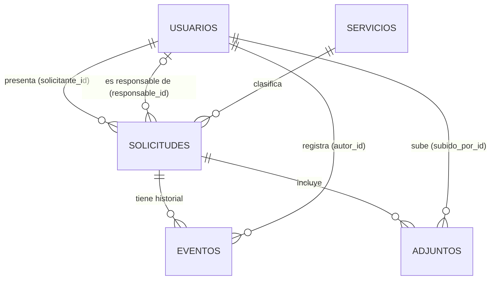

# Diseño – Sistema de gestión de solicitudes de servicio (PF-01)

**Autor:** Berrio (GitHub: KBerrioC)
**Insumos:** [requisitos.md](requisitos.md) y [entrevista.md](entrevista.md)

> **Estado:** en elaboración. Este documento se completa por partes; los apartados marcados como _Pendiente_ se añaden en pull requests posteriores.

## Contenido

1. [Decisiones técnicas](#1-decisiones-técnicas)
2. [Arquitectura](#2-arquitectura) _(pendiente)_
3. [Modelo de datos](#3-modelo-de-datos)
4. [Especificación de la API](#4-especificación-de-la-api) _(pendiente)_
5. [Reglas de negocio y control de acceso](#5-reglas-de-negocio-y-control-de-acceso) _(pendiente)_
6. [Interfaces y recorridos de los actores](#6-interfaces-y-recorridos-de-los-actores) _(pendiente)_
7. [Correspondencia con los requisitos](#7-correspondencia-con-los-requisitos) _(pendiente)_

## 1. Decisiones técnicas

| Capa | Tecnología | Justificación |
|---|---|---|
| Backend y API REST | Python con FastAPI y Pydantic | Es la tecnología trabajada en el curso; valida entradas, genera documentación OpenAPI y facilita los códigos HTTP. |
| Persistencia | SQLite con SQLAlchemy (ORM) | Se usó en las prácticas del curso, no requiere instalar un servidor y permite reproducir la ejecución con pocos pasos. |
| Autenticación | JWT con contraseñas con hash y control por rol | Se parte del ejemplo visto en clase; cubre RNF-01 y los permisos por actor. |
| Frontend | HTML, CSS y JavaScript con `fetch`, servido por el propio backend | No requiere compilación ni un segundo servidor; permite consumir la API real. |
| Pruebas | Documentación interactiva de la API (Swagger) y capturas | La guía acepta herramientas de consulta HTTP del curso y no exige automatización. |

## 2. Arquitectura

_Pendiente._ Incluirá el diagrama de componentes (frontend, API REST, base de datos y almacenamiento de adjuntos) y las responsabilidades de cada uno.

## 3. Modelo de datos

El modelo tiene cinco tablas. Los valores de `rol`, `estado`, `prioridad`, `tipo` y similares se almacenan como texto y se restringen con `CHECK`.

### 3.1 Diagrama entidad-relación

`solicitudes` referencia dos veces a `usuarios`: `solicitante_id` (quien presenta, obligatorio) y `responsable_id` (quien atiende, nulo hasta la asignación). `eventos` referencia tres veces a `usuarios`: `autor_id`, `de_responsable_id` y `a_responsable_id`.

### 3.2 Tablas

**`usuarios`**

| Campo | Tipo | Restricciones y notas |
|---|---|---|
| id | entero | Clave primaria |
| nombre | texto | Obligatorio |
| correo | texto | Obligatorio, único |
| password_hash | texto | Obligatorio; nunca se guarda la contraseña |
| rol | texto | `solicitante`, `atencion` o `coordinacion` |
| tipo_solicitante | texto | Nulo; `estudiante`, `docente`, `egresado` o `externo`, solo para solicitantes |
| activo | booleano | Por defecto verdadero |
| creado_en | fecha y hora | Obligatorio |

**`servicios`**

| Campo | Tipo | Restricciones y notas |
|---|---|---|
| id | entero | Clave primaria |
| nombre | texto | Obligatorio, único |
| descripcion | texto | |
| requiere_adjunto | booleano | Si es verdadero, la solicitud exige al menos un adjunto (RN-06) |
| prioridad_defecto | texto | `alta`, `media` o `baja` (RN-09) |
| activo | booleano | Por defecto verdadero |

**`solicitudes`**

| Campo | Tipo | Restricciones y notas |
|---|---|---|
| id | entero | Clave primaria |
| radicado | texto | Obligatorio, único; formato `SOL-AAAA-NNNNN` |
| solicitante_id | entero | FK → `usuarios.id`, obligatorio |
| servicio_id | entero | FK → `servicios.id`, obligatorio |
| asunto | texto | Obligatorio |
| descripcion | texto | Obligatorio |
| estado | texto | `recibida`, `en_evaluacion`, `pendiente_informacion`, `en_gestion`, `finalizada`, `rechazada` o `cancelada` |
| prioridad | texto | `alta`, `media` o `baja`; copia la del servicio al crear y puede ajustarse (RN-09) |
| responsable_id | entero | FK → `usuarios.id`, nulo hasta asignar; debe ser personal de atención (RN-07) |
| respuesta | texto | Nulo hasta finalizar (RN-04) |
| creado_en | fecha y hora | Obligatorio |
| actualizado_en | fecha y hora | Obligatorio |
| finalizado_en | fecha y hora | Nulo hasta finalizar |

**`eventos`** (historial de trazabilidad)

| Campo | Tipo | Restricciones y notas |
|---|---|---|
| id | entero | Clave primaria |
| solicitud_id | entero | FK → `solicitudes.id`, obligatorio |
| autor_id | entero | FK → `usuarios.id`, obligatorio |
| tipo | texto | `creada`, `evaluacion_iniciada`, `informacion_solicitada`, `informacion_recibida`, `aceptada`, `rechazada`, `asignada`, `reasignada`, `prioridad_cambiada`, `nota`, `finalizada` o `cancelada` |
| estado_anterior | texto | Nulo |
| estado_nuevo | texto | Nulo |
| de_responsable_id | entero | FK → `usuarios.id`, nulo; para reasignaciones (RN-08) |
| a_responsable_id | entero | FK → `usuarios.id`, nulo; para asignaciones y reasignaciones (RN-08) |
| detalle | texto | Nulo; motivo, nota o comentario |
| visible_solicitante | booleano | Falso para notas internas (RN-05) |
| creado_en | fecha y hora | Obligatorio |

**`adjuntos`**

| Campo | Tipo | Restricciones y notas |
|---|---|---|
| id | entero | Clave primaria |
| solicitud_id | entero | FK → `solicitudes.id`, obligatorio |
| subido_por_id | entero | FK → `usuarios.id`, obligatorio |
| proposito | texto | `solicitud`, `informacion` o `respuesta` |
| nombre_original | texto | Nombre del archivo que subió el usuario |
| nombre_almacenado | texto | Nombre aleatorio con el que se guarda en disco |
| tipo_mime | texto | PDF, JPG o PNG (RNF-05) |
| tamano_bytes | entero | Máximo definido por `MAX_UPLOAD_MB` (RNF-05) |
| creado_en | fecha y hora | Obligatorio |

### 3.3 Integridad e índices

- Todas las claves foráneas usan `ON DELETE RESTRICT`: no se elimina un usuario, servicio o solicitud con registros asociados.
- En SQLite se activa `PRAGMA foreign_keys = ON` en cada conexión; de lo contrario las claves foráneas no se hacen cumplir (RNF-04).
- Restricciones `CHECK` en `rol`, `estado`, `prioridad`, `tipo` y `proposito`.
- Índices en `solicitudes` por `estado`, `responsable_id`, `solicitante_id` y `servicio_id`, y en `eventos` por `solicitud_id` y `creado_en`, para la bandeja y el resumen.

### 3.4 Decisiones de diseño

1. **Una sola tabla de usuarios con rol.** La autenticación se resuelve una vez y la base de datos garantiza que cada referencia apunte a un usuario existente. Que el solicitante tenga rol `solicitante` y el responsable rol `atencion` lo valida la aplicación (RN-07).
2. **Los tiempos se calculan, no se guardan.** El tiempo pendiente y el tiempo de atención salen de `creado_en` y `finalizado_en` (RN-10), por lo que nunca quedan desactualizados.
3. **Todo el historial en una tabla.** Cambios de estado, asignaciones, prioridad y notas son filas de `eventos`; el campo `visible_solicitante` decide qué ve cada rol (RN-05).
4. **Reglas en la aplicación.** Las transiciones de estado (RN-01), la exigencia de motivo (RN-02), el responsable obligatorio en «En gestión» (RN-03) y la inmutabilidad de estados finales (RN-12) se validan en el servicio, porque dependen del flujo y no solo de un valor.
5. **Adjuntos en disco, metadatos en la base de datos.** El archivo se guarda con un nombre aleatorio fuera del control de versiones y solo se descarga por un endpoint autorizado (RNF-05).

### 3.5 Correspondencia con los requisitos

| Tabla | Requisitos que respalda |
|---|---|
| `usuarios` | RF-01, RF-02, RF-03, RN-07 |
| `servicios` | RF-04, RN-06, RN-09 |
| `solicitudes` | RF-05, RF-07, RF-08, RF-09, RF-10, RF-11, RF-13, RF-14, RF-16, RF-18, RF-19 |
| `eventos` | RF-15, RF-17, RN-05, RN-08, CA-04 |
| `adjuntos` | RF-06, RF-12, RF-16, RNF-05 |

## 4. Especificación de la API

_Pendiente._ Incluirá los recursos, métodos HTTP, formatos de solicitud y respuesta, validaciones, códigos de error y permisos de cada endpoint, justificados por el proceso (RNF-09).

## 5. Reglas de negocio y control de acceso

_Pendiente._ Incluirá cómo se aplican RN-01 a RN-12 y la matriz de permisos por rol en el servidor.

## 6. Interfaces y recorridos de los actores

_Pendiente._ Incluirá los recorridos principales de solicitante, personal de atención y coordinación, y los prototipos de las pantallas.

## 7. Correspondencia con los requisitos

_Pendiente._ Tabla que relaciona cada decisión de diseño con los requisitos de [requisitos.md](requisitos.md).
